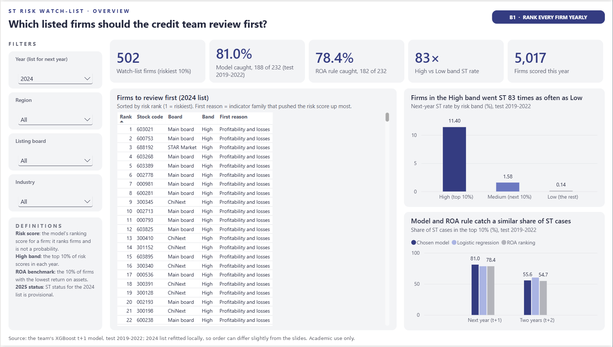
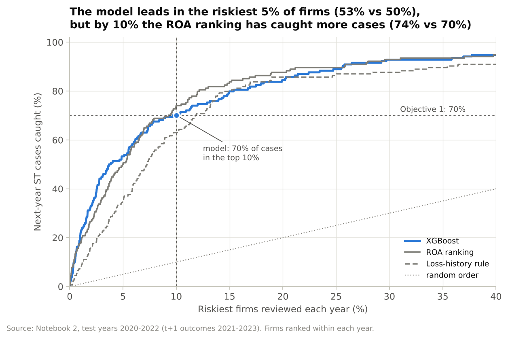
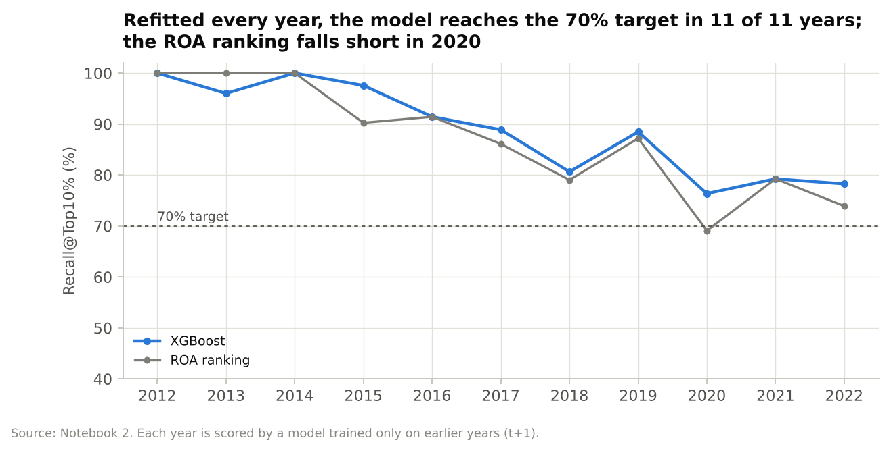
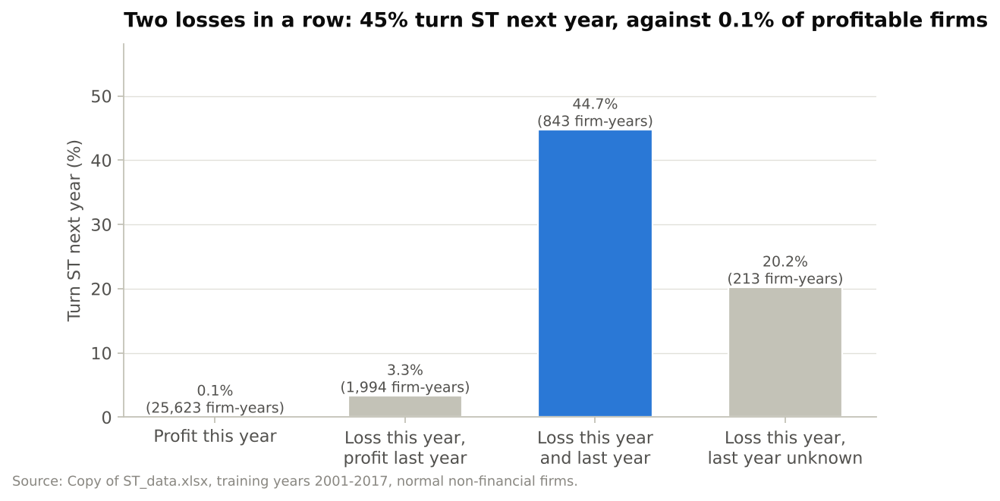
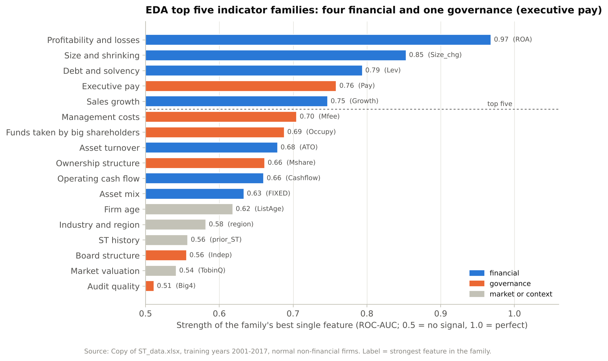
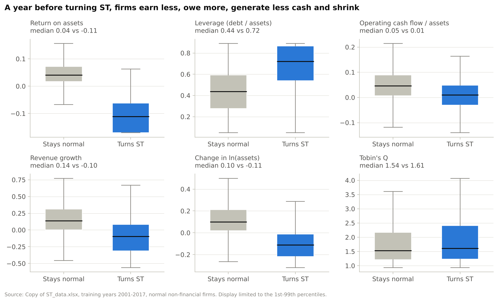
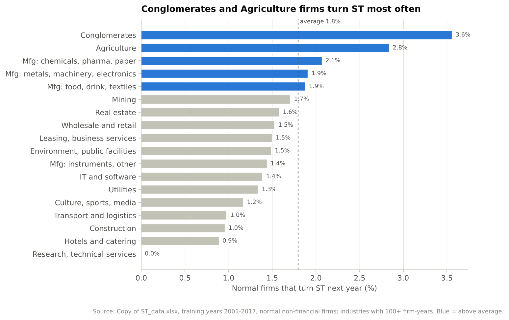

# A-Share ST Watch: an early-warning list for China's "special treatment" stocks

Which listed Chinese firms are likely to be put under **ST / \*ST** (the exchange's "special treatment" warning for financial distress) next year, and why?

Built by a five-person team in Oct 2026 for a lender's credit-risk team that wants a ranked list of firms to review first each year. This repository holds **the parts I built**, and it credits my teammates for theirs.


*The Power BI dashboard I built (page 1 of 3). Its numbers come from the team's final model, built by a teammate.*

---

## My role

I'm **Sivadas Warrier Dhananjay**. In the team I owned the data-to-insight part of the pipeline and the reporting layer:

| What I did | Where it is |
|---|---|
| **Data profiling and quality audit** of 62,669 firm-years (5,365 firms, 2001-2024): duplicate columns, unit and scale problems, impossible values, label checks (ST next year really matches next year's status: 0 mismatches) | [Notebook 01](notebooks/01_eda_cleaning_features_and_my_model.ipynb), Part 1, sections 2-3 |
| **Cleaning** with a logged rule for every change: 170 impossible values set to blank, shares put on one scale, extreme values capped using training-year limits only, and **no rows deleted** | Part 1, section 4 |
| **Feature engineering**: 14 new warning signals (listing board, year-on-year changes, distress flags, ST history, industry-relative ratios) and a feature dictionary | Part 1, section 5 |
| **Leakage-safe design**: a time split (train 2001-2017, choose on 2018-2019, test once on 2020-2022) instead of a random split, which would have inflated recall from 70% to 89% | Part 1, section 6, and Part 2, section 13 |
| **Exploratory analysis**: ST rates by group, ratios one year before ST, single-signal strength (ROC-AUC), loss history, correlation, drift over time, and the top indicator families | Part 1, section 7 |
| **An independent modelling pipeline** (details below) | Part 2 |
| **Power BI dashboard**: Overview, Firm detail and Model check pages; slicers for year, region, board and industry; a custom theme | [screenshot](images/powerbi/overview_page.png), [theme](powerbi/dashboard_theme.json) |
| **Verification notebook**: re-derives 171 numbers on the final slides and dashboard from the raw data, **three different ways each**. Result: 164 PASS, 7 model numbers slightly off because of a different xgboost build, 0 failures | [Notebook 02](notebooks/02_verify_every_deck_number.ipynb) |
| **Final presentation deck** (structure and charts) | not included |

Every notebook prints `PASS` / `CHECK` lines that pin its key numbers: 38/38 for the EDA part and 26/26 for the modelling part.

## Team and credits

| Role | Contribution |
|---|---|
| **Business lead** (teammate) | Business problem, objectives, project plan, integration |
| **Data-warehouse lead** (teammate) | MySQL star-schema data warehouse and OLAP queries |
| **Modelling lead** (teammate) | **The team's final model**: modelling, tuning (Optuna), SHAP explanations, evaluation |
| **Deployment lead** (teammate) | AWS batch-scoring deployment and the live demo |
| **Sivadas Warrier Dhananjay** (me) | Data profiling, cleaning, features, EDA, Power BI, deck, verification notebooks, and the independent pipeline below |

Teammates are listed by role only, until they confirm they are happy to be named here. Their code is not in this repository. It belongs to them.

## Results

### The team's final model (built by the modelling lead)
Next-year XGBoost model, tested on 2019-2022. Its riskiest 10% of firms caught **81.0% of the firms that went ST (188 of 232)**. A simple "lowest return on assets (ROA)" ranking caught 78.4% (182 of 232). Firms in the High band went ST **83 times as often** as firms in the Low band. The 2024 watch-list has 502 firms out of 5,017 scored. These are the numbers on the dashboard.

### My independent pipeline (Notebook 01, Part 2)
I built a second, full modelling pipeline next to the team's model, as a cross-check. **It is not the team's final model.**

- Compared five model families (logistic regression, decision tree, random forest, XGBoost, neural network) with time-ordered cross-validation and five ways of handling the roughly 1% class imbalance (no fix, class weights, over-sampling, under-sampling, SMOTE; no fix won).
- **Test 2020-2022:** XGBoost's riskiest 10% caught **70.1% of next-year ST cases (108 of 154; 95% interval 63.2-77.4%)**.
- **It does not beat the simple ROA ranking on that headline number** (74.0%). I report this openly, because a strong one-column baseline is a real finding. The model's edge is elsewhere:
  - **Top 5% of the list:** 53.2% vs 50.0%.
  - **Refitted every year:** 77.9% vs 74.0% on the test years, and 63.0% vs 54.3% on 2023 accounts (2024 status).
  - **Two years ahead** (random forest): 59.9% vs 54.7%.
  - **Reasons for each firm** (top three indicator families), which a single ratio can't give.
- Error and fairness checks by listing board, ownership and region, and seven robustness checks, including shuffled labels and walk-forward refits from 2012 onwards.
- **Top indicator families** (EDA rank and model rank combined): profitability and losses, then debt and solvency, then size and shrinking.

<p float="left">
  
  
</p>

### Selected EDA figures
<p float="left">
  
  
  
  
</p>

## Repository layout

```
notebooks/
  01_eda_cleaning_features_and_my_model.ipynb   Part 1: profiling, cleaning, features, EDA. Part 2: my independent model
  02_verify_every_deck_number.ipynb             re-derives every slide and dashboard number three ways
images/                                         EDA, model and Power BI screenshots
powerbi/dashboard_theme.json                    dashboard theme
data/README.md                                  how to supply the data (not included)
requirements.txt
```

## How to run

1. `pip install -r requirements.txt`
2. Put your own licensed copy of `Copy of ST_data.xlsx` in `data/` (see [data/README.md](data/README.md)).
3. Run Notebook 01 top to bottom (about 25 minutes on a 4-core laptop). It writes `outputs/` and `models/`, which git ignores.
4. Notebook 02 uses the raw file plus the `cleaned_data.xlsx` that Notebook 01 writes.

## Data and licence notes

- The ZxData dataset is **licensed for academic use only**. This repository holds no raw data, risk scores or firm-level financial figures. Where outputs showed firm-level rows, they were removed from this repository. Stock codes appear only as ranks on the watch-list.
- ST status for 2025 was provisional at the time of the project (its source was not documented). Notebook 01 still runs a 2025 forward check, labelled provisional throughout, but no result in this README depends on it.
- **AI use:** I built these notebooks with help from Claude (Anthropic). I checked every number in them against the code output.
